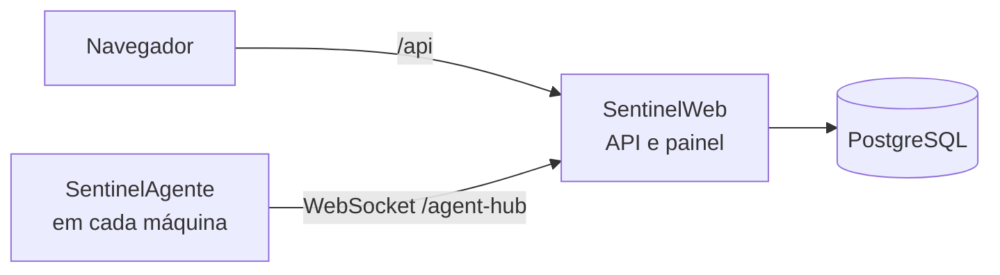

<div align="center">

<picture>
  <source media="(prefers-color-scheme: dark)" srcset=".github/readme/torre-escuro.svg">
  <source media="(prefers-color-scheme: light)" srcset=".github/readme/torre-claro.svg">
  
</picture>

# SentinelAgente

**O agente do [SentinelWeb](https://github.com/pauloeduas-software/SentinelWeb): conta ao painel o que cada
máquina Linux é e como ela está, e desliga, reinicia ou suspende quando o painel pede.**

[](./LICENSE)
[](https://github.com/pauloeduas-software/SentinelAgente/actions/workflows/ci.yml)

</div>

O SentinelAgente é um serviço do systemd que fica em cada computador e conversa com o SentinelWeb. Ele diz
ao painel o que a máquina é e como ela está, e executa os três comandos de energia que o painel oferece. A
série que ele lê do firmware liga a máquina ao computador cadastrado com ela no SentinelWeb. É para quem cuida
da TI e usa o SentinelWeb: quem guarda e mostra é o painel.

> [!NOTE]
> Só Linux: Ubuntu 24.04 ou mais novo, em amd64 ou arm64. Fala só com o SentinelWeb, e o log é em português
> do Brasil. Roda como root, e o `.deb` se monta a partir do código-fonte.

## O que ele manda e o que não manda

- **Quem a máquina é,** a cada conexão, uma vez por dia e no Atualizar agora: o nome, o sistema, o
  processador, o MAC e o IP da placa da rota padrão, a série, o UUID, o fabricante e o modelo, as placas de
  vídeo e a versão do agente. Valor de fábrica, como `To Be Filled By O.E.M.`, não vai.
- **Como ela está,** de hora em hora e no Atualizar agora: a CPU, na média desde a leitura anterior, a memória
  e cada disco local.
- **Um id só da instalação,** sorteado no primeiro arranque e guardado em `/var/lib/sentinel-agent/hwid`. A
  máquina reinstalada, o SentinelWeb reconhece pela série e pelo UUID.
- **O que não vai:** os programas instalados, o usuário logado, a telemetria de rede, os processos e o uso da
  placa de vídeo. A leitura feita sem conexão se perde: nada fica guardado para depois.
- **Nada escondido:** o agente aparece como `sentinel-agent` no `ps` e no `systemctl status`, e para com
  `systemctl stop`.
- **Só `wss://`,** com o certificado sempre conferido; o `ws://`, sem criptografia, só vale com o SentinelWeb
  na mesma máquina, como em desenvolvimento. Cada máquina tem o seu token, que o cadastro troca pelo segredo
  de instalação, e o agente apaga o segredo depois.

De onde sai cada campo, e o que o SentinelWeb faz com ele, está em
[`protocolo.md`](./docs/referencia/protocolo.md).

## Os comandos que aceita

| No painel | No agente |
|---|---|
| Desligar | `systemctl poweroff` |
| Reiniciar | `systemctl reboot` |
| Suspender | `systemctl suspend` |
| Atualizar agora | manda na hora quem a máquina é e como ela está |

O `/usr/bin/systemctl` roda direto, sem shell, e os bloqueios do logind valem. Qualquer outro comando é
recusado e vai para o log (`journalctl -u sentinel-agent`), que diz também, com o id do comando, se o systemd
aceitou ou por que recusou. O SentinelWeb não guarda comando para depois: a máquina desconectada não recebe
nada.

## Como funciona



O agente é C# com .NET 10, fica conectado ao SentinelWeb e reconecta sozinho quando a conexão cai.

## Instalar

Monte o `.deb` num clone do repositório, com o SDK do .NET 10:

```bash
./packaging/build-deb.sh          # artifacts/sentinel-agent_<versão>_amd64.deb
./packaging/build-deb.sh arm64    # para ARM
```

Leve o pacote para a máquina e instale com o endereço do SentinelWeb e o segredo de instalação, o
`AGENT_ENROLL_SECRET` de lá. O SentinelWeb atende em HTTP: o `wss://` precisa de um proxy com TLS na frente dele.

```bash
sudo SENTINEL_URL=wss://<servidor>/agent-hub SENTINEL_ENROLL_SECRET=<segredo> \
  apt install ./sentinel-agent_<versão>_amd64.deb
systemctl status sentinel-agent
journalctl -u sentinel-agent -f
```

O `apt` traz o runtime do .NET junto. Instalar sem o segredo no `ps`, o servidor com certificado interno,
atualizar, recadastrar e remover estão em [`instalar-o-agente.md`](./docs/guias/instalar-o-agente.md).

## Compilar

Precisa do SDK do .NET 10.

```bash
dotnet build
dotnet test      # os testes leem o testdata/ e não pedem root
dotnet format
```

Rodar o agente na máquina de desenvolvimento, contra um SentinelWeb local, está em
[`preparar-o-ambiente.md`](./docs/guias/preparar-o-ambiente.md).

## Documentação

- [`docs/README.md`](./docs/README.md): o mapa da documentação e por onde entrar.
- [`arquitetura.md`](./docs/referencia/arquitetura.md): as pastas, o que cada uma guarda e quem usa quem.
- [`protocolo.md`](./docs/referencia/protocolo.md): o que o agente manda e recebe, e o que o SentinelWeb faz com isso.
- [`decisoes/`](./docs/decisoes/README.md): o porquê de cada regra.

Dúvida ou bug: abra uma [issue](https://github.com/pauloeduas-software/SentinelAgente/issues).

## Licença

**[GNU GPL, versão 3 ou posterior](./LICENSE)** (`GPL-3.0-or-later`). Qualquer um pode usar, alterar e
redistribuir. Quem distribuir o agente, alterado ou não, oferece o código-fonte junto, com a mesma licença. Vem
sem garantia nenhuma. As bibliotecas do .NET que vão no pacote seguem com a licença delas, a MIT. O porquê da
escolha está na [A29](./docs/decisoes/plataforma.md#a29--a-licença-é-a-gpl-versão-3-ou-posterior).
